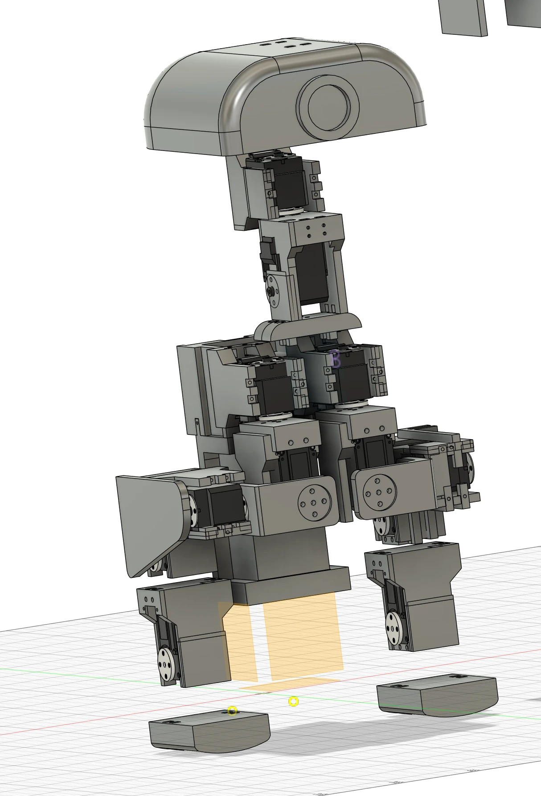

# merobot – Robot Simulation Notes

_Started 2026-10-11_

Goal: simulate our 3D-printed legged robot (designed in Fusion 360) in MuJoCo, and eventually train walking policies that transfer to the real robot.

## Our robot

_Our own design in Fusion 360, as of 2026-10-11._ A duck-style biped (similar layout to the Microduck and the Open Duck Mini): a head on a servo neck, a torso, servo-driven legs, and separate rounded feet (shown detached in this view).

---

## 1. Where things are

| What | Where |
|---|---|
| Fusion 360 design (source of truth) | Fusion 360 cloud |
| Daily STL print exports | `D:\Code\microente\<dd.mm>\` (127 STLs, no other file types) |
| Simulation project | `D:\Code\merobot\` (this folder) |

Part names in the STLs suggest a biped with **Feetech STS3215** and **996 (MG996R?)** servos: `STS3215ServoHolder`, `996ServoHolder`, `Foot_Left`, `leg`, `StepRod`, `BatteryHolder`, `TopPlate`, `HeadTop`, etc.

---

## 2. Why the STLs alone are not enough

A simulator needs a **robot description** (MJCF for MuJoCo, URDF for PyBullet/Gazebo/Isaac):

1. **Links**: the rigid bodies, each with a mesh, **mass, center of mass and inertia**.
2. **Joints**: where each servo axis sits, which way it turns, its angle limits, and the parent/child link.
3. **Actuators**: torque, speed, and position-control gains for each servo.
4. **Contacts**: foot friction and collision shapes.

An STL contains only the mesh in (1), with no mass, and each file sits in its **print orientation**, not its position on the robot. The STL folders also have many duplicates (`BatteryHolder (1) (1).stl`, `FootLetMotorBracket2.stl`, …).
→ **Export the model from the Fusion 360 assembly instead of rebuilding it from the STLs.**

---

## 3. Checklist before exporting the full robot

### In Fusion 360
- [ ] **One component per rigid link.** Everything that moves together (bracket + servo body + screws) goes in one component, or is rigid-jointed together.
- [ ] **A Revolute joint at every servo axis**, with the axis on the actual servo shaft and correct angle limits. Static connections get Rigid joints.
- [ ] **A clear root link**, e.g. torso/battery holder named `base_link`.
- [ ] **Clean names:** no spaces, no `(1)`, no `Body102`. Exporters turn these into link names.
- [ ] **Materials on every body** so mass and inertia can be computed. Printed parts are mostly air because of infill, so override with real weights where possible.

### Real-world numbers to collect
- [ ] Weights of printed parts, servos, battery and electronics (kitchen scale is fine).
- [ ] Servo per joint (STS3215 vs 996), **supply voltage** (STS3215 comes in 7.4 V and 12 V versions; the 12 V one has ~50% more torque), stall torque, no-load speed.
- [ ] Foot material / friction (PLA, rubber pad, …).

### Tools
- [ ] Fusion exporter add-in: **ACDC4Robot** (URDF / MJCF / SDF), or **fusion2urdf** (URDF only).
- [ ] Python + MuJoCo (`pip install mujoco`), already installed (Python 3.12.3).

### Open questions
1. What is the sim for: viewing / joint-range checks, gait design, or RL sim-to-real?
2. Does the Fusion design already have joints defined?
3. What does the real robot run on (ESP32, Raspberry Pi, PC over the STS serial bus)?
4. Do we use ROS?

---

## 4. Servo + bar test rig (removed)

The first single-servo test rig (`servo_bar.xml`, `run_sim.py`) has been removed. What it showed: a position actuator capped at the STS3215 stall torque (1.9 N·m) with damping 0.4 reaches about 265 °/s, close to the real no-load speed.

Current files:
- [`generate_mjcf.py`](generate_mjcf.py): generates [`merobot.xml`](merobot.xml) from `parts/*.json`, with the layout of robot_structure.md
- [`render_views.py`](render_views.py): renders `merobot.xml` to `images/merobot_views.png`
- [`parts/`](parts): part definitions (`servo`, `sts3215`, `foot`, `head_box`, `box_body`) and their STL meshes

---

## 4b. Our robot structure notation

The robot is written down as a Unicode box-drawing table of re-usable parts:

- Notation: [merobot_spec.md](merobot_spec.md)
- Our robot: [robot_structure.md](robot_structure.md)

---

## 5. Reference projects: how the Microduck community does it

Repos looked at:
- https://github.com/Vottivott/microduck-playground: stunt behaviors (swing, stilts, climbing, backflip) + printable add-ons, built on top of `microduck_rl`.
- https://github.com/x10zyn/microduck-sim-playground: beginner CPU-only workspace (no GPU, no training); includes Pollen's repos as git submodules, with a hand-posed joint viewer.
- Both build on Pollen Robotics' Microduck:
  - https://github.com/pollen-robotics/microduck_rl: RL training (this is the one to copy)
  - https://github.com/pollen-robotics/microduck: on-robot runtime

Microduck: ~800 g, ~25 cm biped, 14 actuated joints, **Dynamixel XL330** servos.

### Their toolchain

| Layer | Tool | What it does |
|---|---|---|
| CAD | **Onshape** | Robot designed in Onshape |
| CAD → sim model | **onshape-to-robot** | Exports the assembly directly to MJCF (one `config_mjcf_*.json` per model) |
| Physics | **MuJoCo** (CPU) + **MuJoCo Warp** (GPU) | CPU for viewing/testing; GPU for thousands of parallel robots in training |
| RL framework | **mjlab** + **rsl_rl** | Training environments + PPO |
| Servo model | **BAM** (Better Actuator Models), "M6" model | Battery voltage, back-EMF, Coulomb/Stribeck/load-dependent friction; ±1° backlash variants. Used via `bam.mujoco.MujocoController` |
| Robustness | Domain randomization | Battery voltage and sag, command delay, friction (`FrictionDRBamActuator`) |
| Tracking / publishing | **wandb**, **Hugging Face Hub** | Training logs; `uv run publish` uploads policy + `manifest.json` |
| Export | **ONNX** | `uv run scripts/export.py …` with observation normalizer baked in; `[1,61] → [1,14]` graph at 50 Hz |
| On the robot | Rust daemons on Rockchip RK3566 | `robotd` runs the 50 Hz control loop + motor bus, loads the ONNX policy |
| Python tooling | **uv** | `pyproject.toml` + `uv.lock` |

Training: `uv run train Mjlab-Velocity-Flat-MicroDuck --env.scene.num-envs 4096`, which the README says gives a usable walking gait in ~1–2 h on a CUDA GPU. `--hf-jobs` runs training on Hugging Face Jobs instead.

### What this means for us

1. **Model export:** they use onshape-to-robot; our equivalent is **ACDC4Robot**, which exports MJCF directly from Fusion.
2. **Servo model:** the realistic servo model is what makes walking transfer to the real robot. Ours is a simple stand-in.
   **BAM** is the tool for measuring and modeling real servos. It probably already supports **STS3215** (the Open Duck Mini uses them), but this is **not yet checked**.
3. **GPU:** this machine has an **NVIDIA RTX 3060, 12 GB** (driver 591.86), enough for mjlab training at fewer parallel robots than 4096.
   Not yet checked whether mjlab runs natively on Windows; it may need **WSL2**.
4. **Starting point:** copy the structure of `microduck_rl` (folders, tasks, rewards, actuator model, ONNX export) and swap in our robot model and servo model, instead of building our own training setup.

---

## 6. Next steps

1. **Realistic servo model:** add a BAM-style STS3215 model to the servo + bar rig.
2. **Calibrate against the real servo:** same rig in real life (servo + bar of known mass), 90° step, log position/speed from the STS bus, compare to sim, then tune or fit parameters (BAM identification).
3. **Check BAM's STS3215 support** and **mjlab on Windows vs WSL2**.
4. **Clone `microduck_rl`** to see exactly how BAM is wired into mjlab.
5. **Prepare the Fusion assembly** (checklist in §3) and export the full robot with ACDC4Robot.
