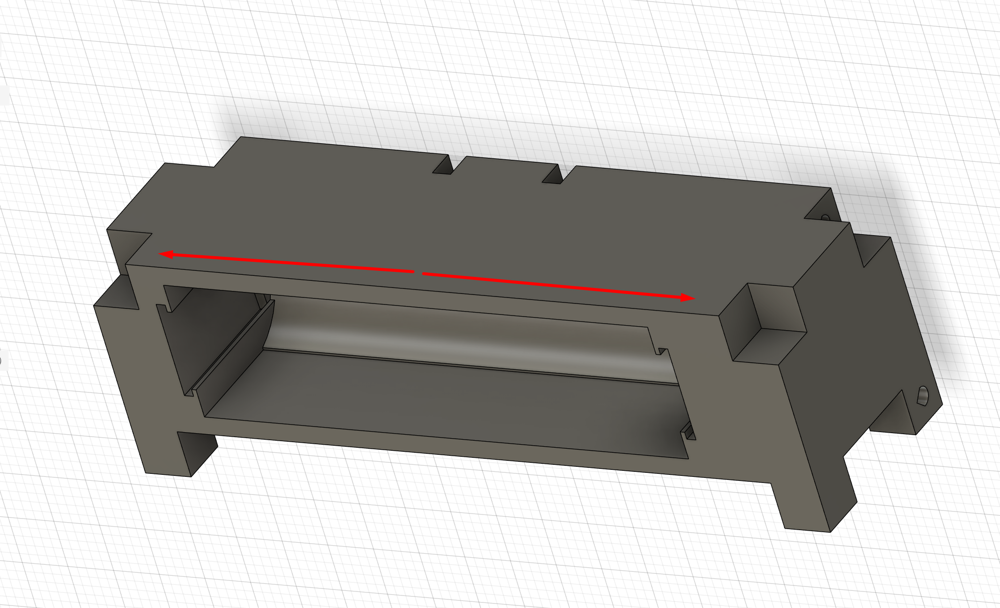
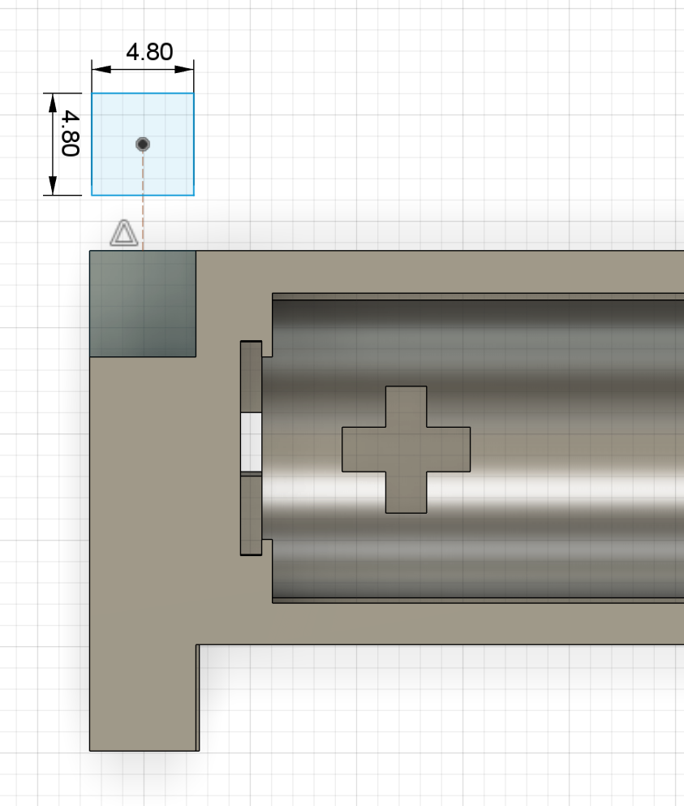
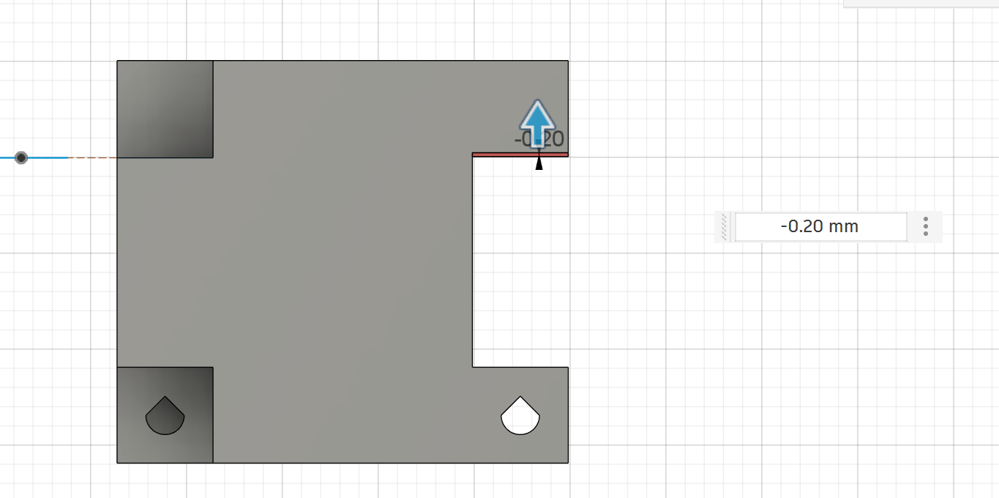
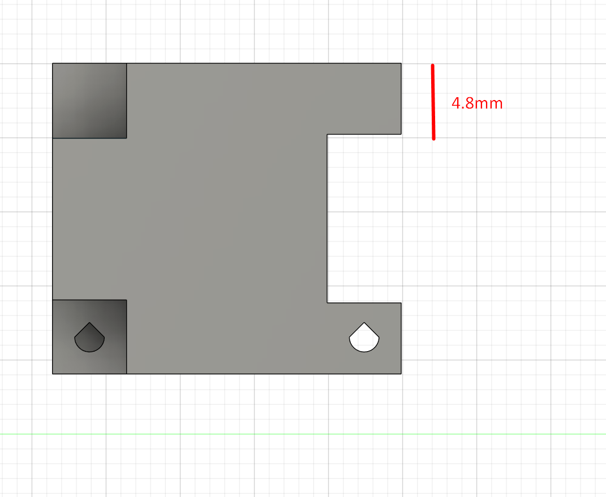
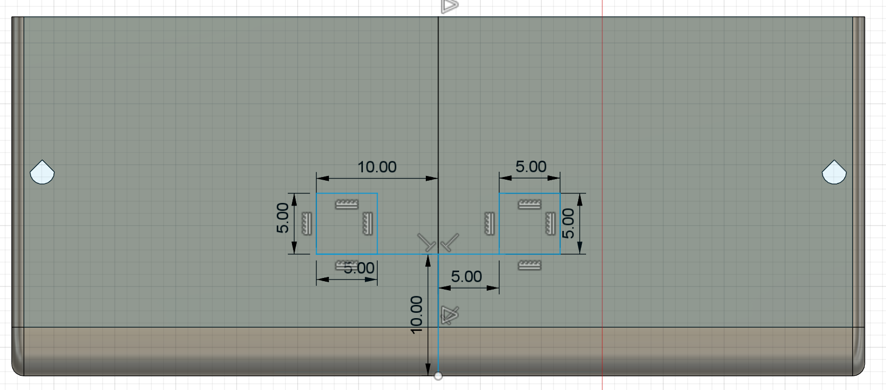
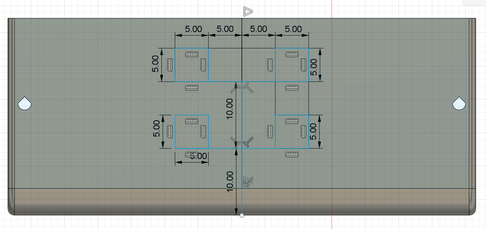
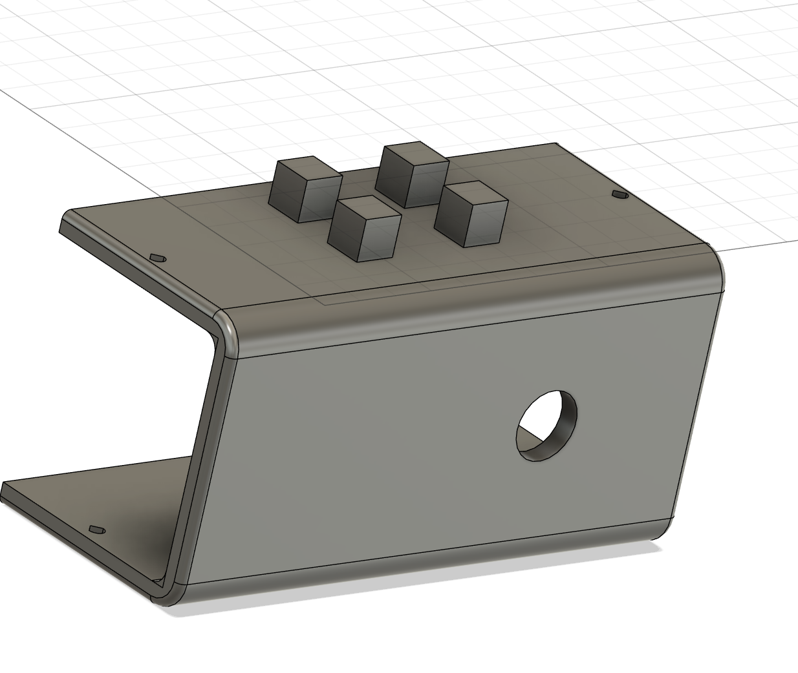

# 5x5 Mechanical Standard

_Draft notes. All dimensions are in millimetres._

## Alignment rule — replaces earlier drafts

**Default: notches, sockets and mating connectors share the same grid centre, with symmetric clearance on all sides.** The limited edge-aligned notch exception for flat printing is described below. This replaces the earlier left-aligned/top-aligned rule that added all clearance to the right or downward.

- Position geometry by its **centre**, then extend half its width and height in each direction. Do not use one edge as the clearance anchor under the default rule; only the documented bottom-clearance exception below permits one-sided relief.
- A **5.3 mm socket around a nominal 5 mm bar** adds **0.15 mm per side**. A **4.8 mm printed connector in a nominal 5 mm notch** leaves **0.1 mm per side**.
- Grid locations such as **x = -10 mm** and instructions to arrange positions rightwards describe **connection centres and layout order**, not one-sided clearance.
- The separate blind-socket insertion-depth allowance remains beyond the bar end; it does not offset the cross-sectional centre.

## Connecting bars

- All parts connect using square bars (rods) with a **nominal 5 × 5 mm** cross-section. Printed male connectors that fit notches must follow the 4.8 mm maximum and centred-clearance rules below.
- Use **2 mm screws** throughout.
- A rod's first screw point must be centred **exactly 2.5 mm from its end**.
- Valid screw-point centres along the rod are **2.5, 5, 7.5, 10 mm, and so on**: a 2.5 mm grid measured from that end.

## Component reference and grid origin

- Use the **midpoint of each component** as the reference for positioning its 5×5 connections, rather than measuring from an outside edge.
- Set the component midpoint to **x = 0**, with positive x running to the right.
- Place the first nominal rod/socket centre **10 mm to the left of the midpoint**, at **x = -10 mm**.
- Arrange the remaining positions **rightwards** from there. With the 10 mm centre-to-centre pitch below, the centres are **-10, 0, 10, 20 mm, and so on**, as needed.
- These positions refer to the nominal 5 mm rods. Socket clearance does not move the grid or its reference points.

## Notches and printed connectors

- On **any component shape**, two separated notches or connectors must have **centre-to-centre spacing that is a multiple of 5 mm**: 5, 10, 15, 20 mm, and so on. Measure from the shared connection reference, not from an outside edge of the shape.
- **Notch centres must align exactly with the 5 mm grid.** A holder using the 10 mm pitch described below occupies every second grid position; that pitch is a valid multiple of 5 mm.
- By default, centre each mating connector **on the centre of its notch**, in both width and height. The edge-aligned flat-printing exception below is the only permitted local departure described here.
- For **3D-printed male connectors**, the cross-section must be **no more than 4.8 mm wide and 4.8 mm high**.
- Under the default rule, distribute clearance **equally on every side**. Sketch the connector from the notch centre: a maximum-size connector extends **2.4 mm left, right, above and below** that centre. Do not start at a notch edge and measure 4.8 mm inward, which would shift the connector off-centre.
- For example, in a **nominal 5 × 5 mm notch**, a centred 4.8 × 4.8 mm connector leaves **0.1 mm clearance on each side**. The 5.3 mm rod sockets specified below are a separate receiving-opening allowance; a 4.8 mm printed connector centred in a 5.3 mm opening leaves **0.25 mm on each side**.
- Connector undersizing and socket clearance must **not redefine the nominal grid or connection centres**. A small local component offset is permitted only for the edge-aligned flat-printing exception below and must be recorded and checked.

### Notch spacing example

The notches on opposite sides of this battery holder use the same 5 mm connection grid, regardless of the surrounding body shape. Their centre-to-centre separation must be a multiple of 5 mm.

### Centred printed connector example

The connector is dimensioned 4.8 × 4.8 mm from its centre, which aligns with the corresponding notch centre.

## Edge-aligned notch exception for flat printing

- Use this exception **only where a notch is aligned with an outside edge** and the normal centred treatment would shift the notch slightly downward or interfere with a flat printing face.
- To keep the print face flat, it is permitted to put the required **clearance at the bottom of the notch**, rather than shifting the whole notch downward. Keep the edge-aligned face flush; make the relief at the bottom mating face.
- This is a **limited one-sided vertical clearance exception**, not a return to the old general left-alignment rule. Keep the horizontal alignment centred and retain the normal rules everywhere else.
- The **4.8 mm maximum width and height for printed connectors still apply**. The diagrams show a 0.20 mm adjustment and a resulting 4.8 mm edge feature as an example; choose the relief for the actual mating geometry.
- The assembled component can sit **slightly offset from its nominal grid position** as a result. Use the exception **carefully and infrequently**; do not move the shared grid to hide the offset.
- Record which notch uses the exception, the relief amount and the resulting component offset in the part's design notes.
- Before using it, check that there is **enough room for the mating part to fit and be inserted**: inspect nearby surfaces and other connectors so the offset does not cause interference, block assembly or force another connection out of alignment. If there is not enough room, retain the standard centred design or revise the surrounding geometry.

## Holders and rod spacing

- In a complex holder, keep **5 mm between adjacent 5 mm rods**.
- Draft interpretation: this is the clear gap between nominal rod edges, giving a **10 mm centre-to-centre pitch**. Confirm this interpretation before treating the draft as final.
- Rod sockets must accept a **5 × 5 mm** square rod in a **5.3 × 5.3 mm** opening: **0.3 mm total clearance per axis**.
- **Centre each socket on its nominal rod position.** Distribute the extra 0.3 mm equally: **0.15 mm to the left and 0.15 mm to the right**, and likewise **0.15 mm above and below**. The socket and rod share the same centre; do not left-align or top-align the socket.

Example with 5.3 mm sockets and a nominal 5 mm gap, measured from the component midpoint (x = 0):

| Feature | Horizontal extent |
|---|---|
| First nominal rod (centre -10 mm) | -12.5 to -7.5 mm |
| First socket (centre -10 mm) | -12.65 to -7.35 mm |
| Second nominal rod (centre 0 mm) | -2.5 to 2.5 mm |
| Second socket (centre 0 mm) | -2.65 to 2.65 mm |

Each socket extends **0.15 mm beyond each side** of its nominal rod. The gap between the two socket edges is **4.7 mm**, from x = -7.35 mm to x = -2.65 mm, while the nominal rod centres stay at -10 and 0 mm. Apply the same centred clearance vertically. This cross-sectional clearance does not change the separate insertion-depth allowance below.

## Depth and front alignment

- The nominal connection depth has two options: **5 mm or 10 mm**. These are the bar engagement dimensions, before socket clearance.
- Use **10 mm as the preferred starting depth**, to leave room for a **fillet**.
- When components all use the **10 mm nominal depth**, align their **front faces on a common plane**.
- A blind socket that receives a bar must have **0.3 mm of additional insertion-depth clearance**: a nominal **5 mm** engagement requires a **5.3 mm-deep socket**, and a nominal **10 mm** engagement requires a **10.3 mm-deep socket**.
- Add this clearance beyond the bar's nominal end; it does not change the connection grid or front-face alignment.

## Connection height and mounting plates

- The standard connection block height is **5 mm overall**.
- A block without a mounting plate is **5 mm high**.
- For a plate-mounted block, use a **1 mm bottom plate** and a **4 mm extrusion above it**, keeping the total height at **5 mm**.
- Hole centres must remain in the same position in either construction: **2.5 mm above the overall bottom** and **2.5 mm from the side** of the nominal 5 mm block.
- Measure the vertical hole position from the **underside of the bottom plate**, not from its top surface. With a 1 mm plate, the hole centre is therefore **1.5 mm above the plate's top surface**.

## Panel screw holes

- Place the screw-hole centre **2.5 mm from the relevant panel edge**.
- The screw opening must be **2 mm wide**.

## Block fastening and screw lengths

- Attach connection blocks using **screws**.
- The wall thickness between the screw entry face and the fastening hole may vary between components.
- Keep a selection of **2 mm screws in different lengths, including very long screws**, so the screw length can accommodate the wall thickness and reach the fastening point.
- Choose the screw length to suit the part. Do not introduce awkward shapes, recesses or extensions solely to fit a shorter screw when they would require supports or add printing complexity.

## Printing and hole geometry

- Every object must have a **clearly defined intended print orientation**, identifying the side or face that rests on the print bed.
- Design the object for that orientation and **minimize the need for printing supports**.
- Use **teardrop-shaped holes** to reduce support requirements, oriented for the intended print direction.
- Square rod sockets must still accommodate the specified 5 × 5 mm bar. Any teardrop relief must preserve that fit; its exact profile remains to be defined.
- Wherever possible, make holes pass **all the way through** the object.
- If a rod socket must stop inside the object, use **5.3 mm or 10.3 mm actual socket depth** for the corresponding 5 mm or 10 mm nominal engagement. The **10 mm nominal option is preferred**.

## Visual example

### Four-block holder

A four-block holder with four nominal 5 × 5 mm connection positions, arranged in two rows. The drawing shows the horizontal spacing and the 10 mm depth references.

### Plate-mounted four-block holder

The completed holder illustrates four connection blocks on a mounting plate. Each connection keeps the standard 5 mm total height: 1 mm of plate plus 4 mm of extrusion. Hole centres retain the same 2.5 mm bottom and side offsets as a block without a plate.

